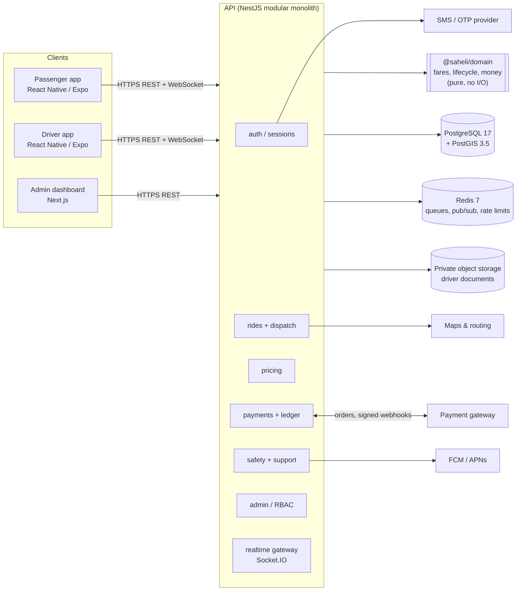
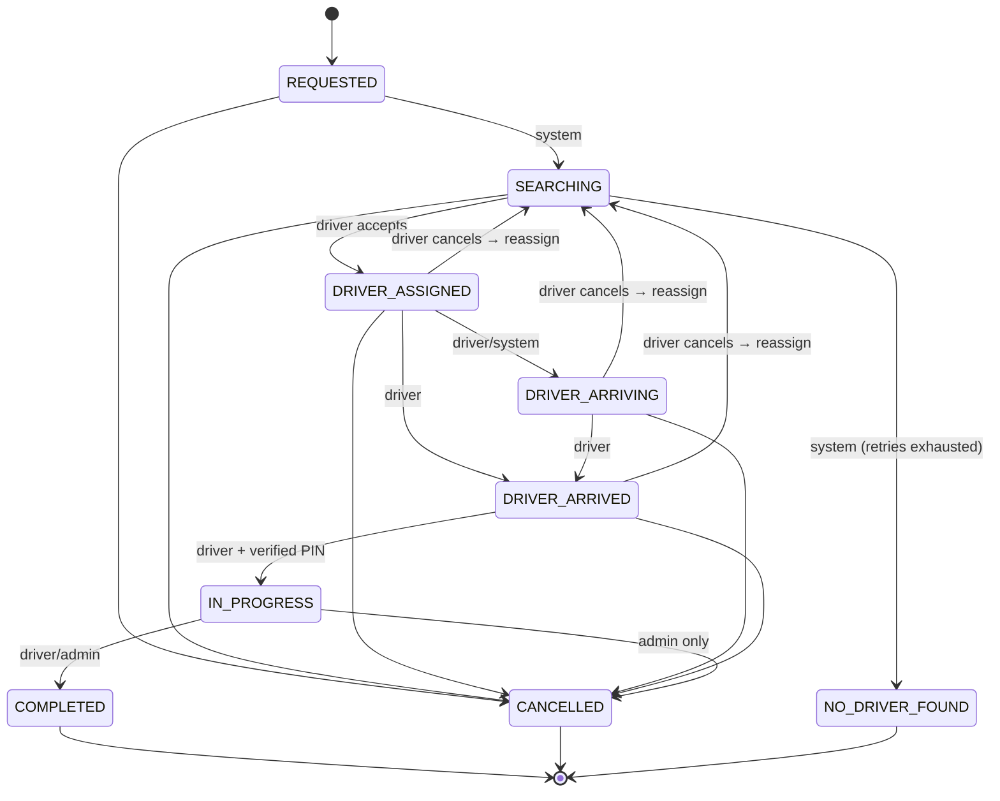
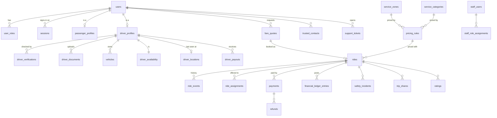

# Architecture

_Working name: **Saheli Rides**. The name is a placeholder until a trademark search clears it._

## System overview

**Status legend:** what exists today is tracked in [TASKS.md](TASKS.md). As of Phase 2, the API
has auth, sessions, profile, health and the full database schema. Everything else in the
diagram is designed but not built.

## Boundaries

| Layer               | Owns                                                                                | Must not                                                   |
| ------------------- | ----------------------------------------------------------------------------------- | ---------------------------------------------------------- |
| `packages/domain`   | Fare maths, ride state machine, cancellation rules, settlement split, phone parsing | Do I/O, read config, import Nest                           |
| `apps/api` modules  | Persistence, authorisation, transactions, integrations                              | Re-implement domain rules                                  |
| Mobile / admin apps | Presentation, input, device capabilities                                            | Calculate fares, decide eligibility, trust their own state |

The server is the only authority for money, ride state and eligibility. Clients display
server-computed values and send intents ("book this quote", "start ride with PIN 4821").

## Key invariants and where they are enforced

| Invariant                                                | Enforcement                                                                  |
| -------------------------------------------------------- | ---------------------------------------------------------------------------- |
| One live ride per passenger; one engaged ride per driver | Partial unique indexes on `rides`                                            |
| Only one driver wins an offer                            | Partial unique index `ride_assignments_one_accepted_uq` + conditional update |
| Ride cannot start before pickup PIN check                | Domain `assertRideTransition` + `rides_started_verified_ck`                  |
| Ledger always balances                                   | Deferred constraint trigger `financial_ledger_entries_balanced`              |
| Ledger, audit log, ride events are never rewritten       | `forbid_mutation` triggers                                                   |
| Published prices never change                            | `pricing_rules_immutable` trigger; new version = new row                     |
| Money is never fractional                                | Integer paise everywhere; checks reject negatives                            |
| Logout/suspension takes effect immediately               | Guard checks session + account status on every request                       |
| OTP guesses are bounded                                  | Attempt counted atomically before comparison                                 |

## Ride lifecycle

Payment status is a separate column so a failed payment never rewinds a completed trip.

## Data model (core entities)

The schema source of truth is `apps/api/src/database/schema/`. Migrations are in
`apps/api/drizzle/`. Generated migrations are committed; CI fails if the schema and
migrations drift apart.

## Authentication

- **App users** (passengers, drivers): phone + 6-digit SMS OTP. Codes are stored as
  HMAC-SHA256 with a server pepper. Each code allows 5 attempts and expires after 5 minutes.
  Sends are limited per phone (5/hour, 30s cooldown) and per IP.
- **Tokens**: 15-minute HS256 access JWT + opaque 30-day refresh token (stored hashed).
  Every refresh rotates the token. Replaying a rotated token revokes that device's whole
  session family (theft detection). Clients must not run two refreshes in parallel.
- **Staff** (admin dashboard): separate `staff_users` table with email + password +
  mandatory TOTP, and role assignments (SUPER_ADMIN, OPERATIONS, SUPPORT, FINANCE, SAFETY).
  The schema exists; the flows are Phase 5.
- A driver-app token cannot call passenger routes and vice versa (`@Roles` checks both
  the role and the app the session was created from).

## Scaling path

The first deployment is a single modular API with managed Postgres and Redis. Known
steps before running more than one API instance:

1. Move the HTTP throttler storage from memory to Redis.
2. Use the Socket.IO Redis adapter for realtime fan-out.
3. Run dispatch timeouts and notifications on a durable queue (BullMQ), not in-process timers.

Modules talk through service interfaces so a hot module (dispatch, location ingest) can
be extracted later if load proves it necessary. That isn't done up front.
